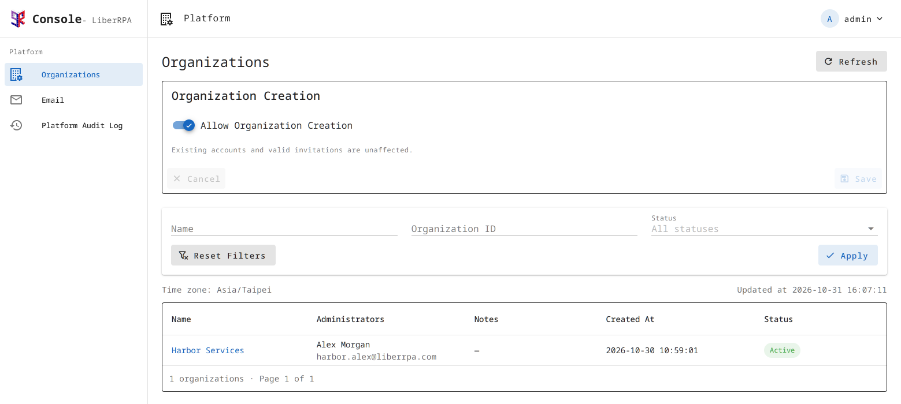

# LiberRPA Console Administration

This guide is for the platform administrator of a Console instance, including people who host their own server. For using the free public service at [console.liberrpa.com](https://console.liberrpa.com), follow the [Console user guide](./README.md).

The platform administrator manages organization access, resource limits, email issues, and platform audit records. Organization administrators manage their own members, departments, and automation resources through the regular workspace.

For installation, HTTPS, host monitoring, backups, upgrades, and recovery, see [Deployment](./DEPLOYMENT.md).

## Contents

- [Sign In](#sign-in)
- [Organizations](#organizations)
- [Usage & Limits](#usage--limits)
- [Email](#email)
- [Platform Audit Log](#platform-audit-log)
- [Account Settings](#account-settings)
- [Password Reset](#password-reset)

## Sign In

Open `/platform/sign-in` on your Console server, for example:

```text
https://console.example.com/platform/sign-in
```

The `Login Name` is always `admin`. Enter the password set during deployment and click `Sign In`. Use `Remember me for 14 days` if you want to keep the browser signed in.

The navigation contains three pages: `Organizations`, `Email`, and `Platform Audit Log`.

Use a regular organization account at `/sign-in` to work with Packages, Executors, Schedules, and other automation resources. The platform administrator account does not open an organization's workspace.

## Organizations

### Organization Creation

The `Allow Organization Creation` switch controls whether people can create new organizations through the public registration page. Change the switch and click `Save`.



Turning it off leaves existing accounts and valid member invitations available. Organization administrators can continue inviting people to their organizations.

### Find an Organization

Filter the list by `Name`, full `Organization ID`, or `Status`, then click `Apply`. Click an organization's name to open `Organization Details`.

The details page has three tabs:

| Tab                | What it shows                                                     |
| ------------------ | ----------------------------------------------------------------- |
| `Overview`       | Organization information, service status, and deletion dates.     |
| `Usage & Limits` | Current resource use and the limits applied to this organization. |
| `Audit Log`      | Platform audit records associated with this organization.         |

The organization's `Audit Log` tab is a filtered view of platform records. The organization's own business audit log is available to its organization administrators in the regular workspace.

### Service Status

The `Overview` tab shows one or more status labels:

| Status                   | Meaning                                                                 |
| ------------------------ | ----------------------------------------------------------------------- |
| `Active`               | Service is available, and organization deletion has not been requested. |
| `Suspended`            | The platform administrator has suspended the organization's service.    |
| `Deletion Scheduled`   | Organization deletion has been requested but has not started.           |
| `Deletion in Progress` | Console has started deleting the organization.                          |

To suspend or resume service, click `Suspend Service` or `Resume Service`, enter a `Reason`, and confirm. The reason is recorded in the platform audit log. Console queues an email notice to the organization's administrators; that email does not include the reason.

Suspension blocks Console business requests for the organization, including Executor heartbeats and result reports. Waiting work is canceled and will not resume automatically. Processes already running on Executor computers may continue, so suspension does not confirm that automation has stopped.

Resuming service allows new work when the organization is otherwise available. It does not replay canceled work or missed Schedule triggers. A scheduled organization deletion remains in place and continues to block business activity. Service status cannot be changed once deletion has started.

For planned server maintenance, use the [maintenance procedure](./DEPLOYMENT.md#maintenance-mode). Maintenance pauses new work while allowing existing Runs and valid reports to continue.

## Usage & Limits

Open an organization and select `Usage & Limits`. The table covers resources such as members, Executors, Packages, stored files, queue data, Run logs, and active Jobs, along with request and transfer limits.

| Column       | Meaning                                                                                               |
| ------------ | ----------------------------------------------------------------------------------------------------- |
| `Used`     | Current usage for the resource.                                                                       |
| `Reserved` | Capacity held for work that has not finished, such as pending invitations or uploads.                 |
| `Limit`    | The limit currently applied to this organization.                                                     |
| `Source`   | `Default` for an inherited instance setting, or `Override` for a value set for this organization. |

A dash means a value is not available or does not apply. For example, request-rate limits do not have a stored usage balance. `Packages per Project` shows the highest number of Package versions in any one Project, rather than the total across all Projects.

Click `Edit Limits` to change values. Each row offers two modes:

- `Inherit Default` follows the instance default, including later changes to that default.
- `Override` uses the value you enter for this organization. Storage fields in the edit dialog use MiB.

Where a field allows `0`, it is an actual limit; it does not mean unlimited or inherited.

Click `Save` to apply your changes. `Reset to Defaults` removes the organization's overrides after showing the affected limits for confirmation.

Lower limits can prevent new activity even when existing usage is already above the new value. Existing files, queue items, and Jobs are kept. Older Run logs and history may be removed as retention limits are applied. Review the warning in the dialog before saving.

Console queues a notice to the organization's administrators when its limits change. If the form reports that limits or defaults have changed since you opened it, use `Refresh Limits` and review the values again.

## Email

The `Email` page shows instance-wide email totals and recent delivery issues.

| Summary              | Meaning                                                                                     |
| -------------------- | ------------------------------------------------------------------------------------------- |
| `SMTP Budget`      | Recipient attempts used in the last 24 hours, compared with the instance limit.             |
| `Run Email Budget` | Run email recipient attempts used in the last 24 hours, compared with their separate limit. |
| `Accepted by SMTP` | Attempts accepted by the SMTP server in the last 24 hours.                                  |
| `Pending`          | Email waiting to be sent.                                                                   |
| `Failed Today`     | Failed email for the date and time zone shown on the page.                                  |

Budgets count recipient attempts, including failed or unknown results. Run email uses both budgets. SMTP acceptance does not confirm delivery to the recipient's inbox.

These totals cover all organizations and do not change when you filter `Recent Issues`.

Filter issues by date, organization, and status, then click `Apply`. The issue statuses are `Failed`, `Not sent`, and `Unknown`. Use the `View Details` icon to inspect the recipient, email type, timestamps, and reason.

Use the reported reason to decide what needs attention. For example, an exhausted budget requires a different response from an SMTP connection error. To change SMTP settings or instance email limits, follow [Configuration changes](./DEPLOYMENT.md#configuration-changes).

Messages marked `Failed`, `Not sent`, or `Unknown` are not retried automatically. Fixing the cause does not resend them. For account verification or password recovery, the user can request a new email through the relevant account page.

## Platform Audit Log

Use `Platform Audit Log` to review recorded platform actions, such as service suspension, limit changes, maintenance changes, and backup operations.

Filter by date, `Actor`, `Organization`, `Action`, or `Result`, then click `Apply`. Date filters use the time zone shown on the page and include both selected dates.

Click `View Details` to see the action, affected object, result, and any recorded reason or before-and-after values. The `Audit ID` and, when present, `Request ID` help identify a specific record during troubleshooting.

Some fields show `Not recorded` because their contents are not retained in the audit record. This does not mean the field was unchanged.

For server errors and service startup problems, use the [diagnostic logs](./DEPLOYMENT.md#logs).

## Account Settings

Open the account menu in the top-right corner to:

- Choose a `Time Zone` for dates and times displayed in Console.
- Select `Use system theme`, `Light theme`, or `Dark theme`.
- `Sign Out`.

The display time zone does not change the instance's backup schedule or server configuration. Those settings are covered in [Deployment](./DEPLOYMENT.md#2-set-the-image-time-zone-and-transfer-budgets).

Use `Refresh` on a page to load its latest data. If a request fails, Console may keep previously loaded results visible and mark them as potentially out of date.

## Password Reset

To change or recover the platform administrator password, follow [Reset the platform administrator password](./DEPLOYMENT.md#reset-the-platform-administrator-password) on the server. A successful reset ends the administrator's existing sessions. Sign in again with the new password.
