# LiberRPA Console

LiberRPA Console is the web application for managing your organization's automation. Use it to connect Executors, upload Project Packages, schedule work, check results, and share data between Projects.

Use the free public service at [console.liberrpa.com](https://console.liberrpa.com). You can create an organization and start using Console without setting up a server.

The public service's limits are set to support frequent use by most users. They protect the shared service from abuse. There are no paid tiers. Organization administrators can check current usage and limits under `Organization Settings > Usage & Retention`.

Projects still run through [LiberRPA Executor](../electronApplications/executor/README.md). Console gives the team one place to manage that work while development stays in [LiberRPA Editor](../docs/Editor.md) and Python.

This guide covers the workspace pages used by organization members and administrators.

- For Python functions that access Console resources, see the [Console Python reference](../docs/Reference.md#console).
- To call Console from other applications, see the [HTTP API guide](./API.md).
- If you want to host Console yourself, see [Deployment](./DEPLOYMENT.md) and [Platform Administration](./ADMINISTRATION.md).

> **Note:**
>
> Screenshots and animations in this document are provided for reference. As LiberRPA evolves, the current interface may differ slightly in appearance or wording, but these minor differences do not affect the documented workflow or functionality.

## Contents

- [Get Started](#get-started)
- [Organizations and Department Access](#organizations-and-department-access)
- [Overview](#overview)
- [Packages](#packages)
- [Executors](#executors)
- [Schedules](#schedules)
- [Job Queue](#job-queue)
- [Run History](#run-history)
- [Assets](#assets)
- [Data Queues](#data-queues)
- [Shared Files](#shared-files)
- [Organization Settings](#organization-settings)
- [Notifications and Account Settings](#notifications-and-account-settings)

## Get Started

Open [console.liberrpa.com](https://console.liberrpa.com) in your browser. If your organization hosts its own Console, use its address instead.

To set up a new organization, choose `Create Organization` on the sign-in page. Verify your email, then enter the organization name and create your administrator account. If you already have an account, sign in with your email address and password.

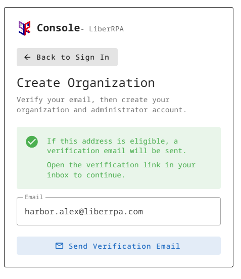

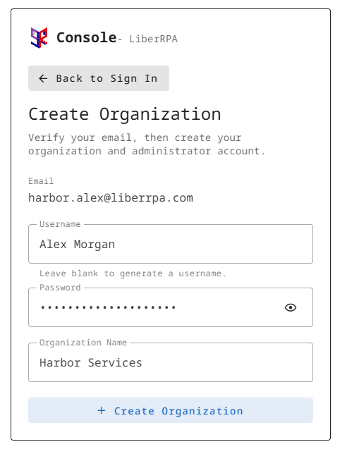

To join an existing organization, use the invitation email from an organization administrator. Creating another organization will not give you access to the existing one.

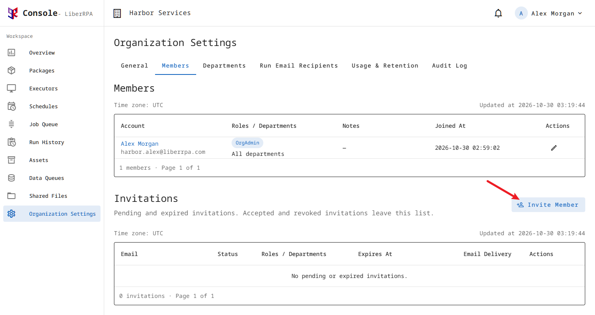

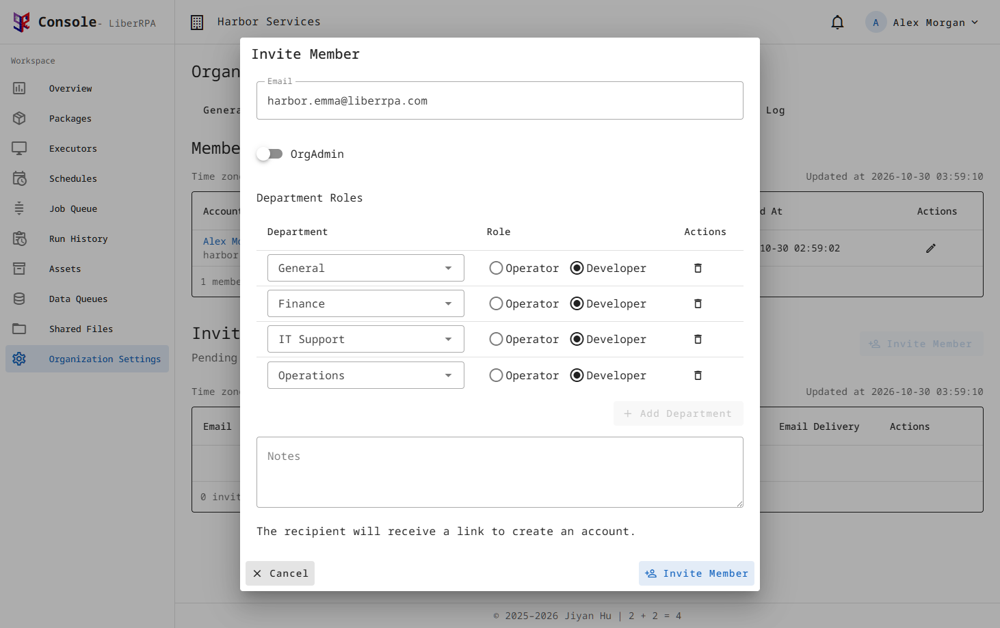

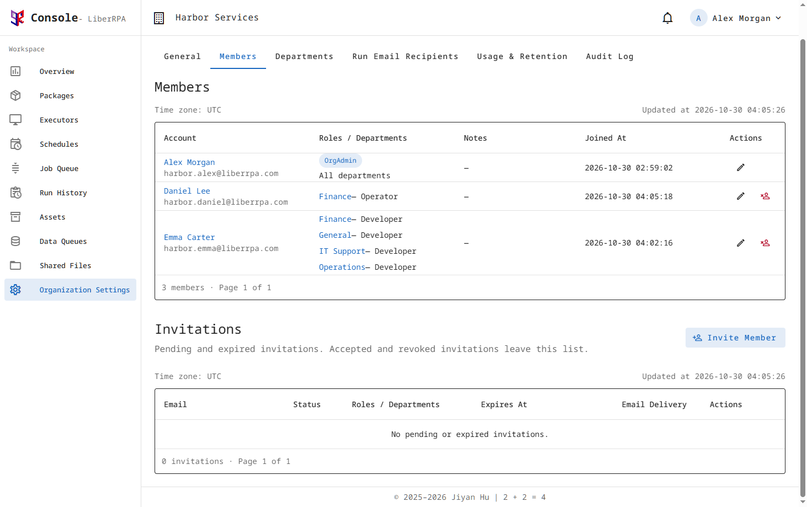

> For a small organization, you can start with an `OrgAdmin` account. The same account can sign in to multiple Editor and Executor clients.

For a first run:

1. An organization administrator creates the required departments and assigns members their roles.
   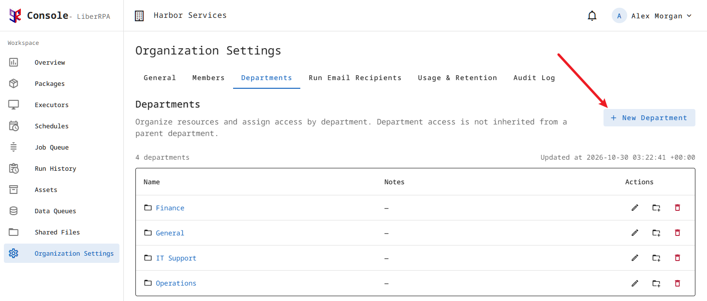
2. In `Executors`, create an Executor record in the department that will own the work.
   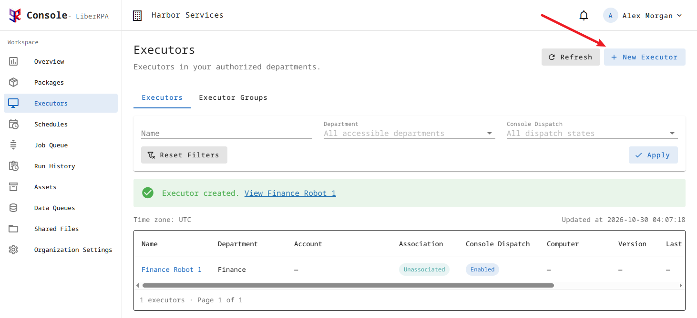
3. On your computer, open Executor's `Console` page, set the Console URL to `https://console.liberrpa.com` or your organization's own address, and sign in. Choose the record under `Select Executor`. In the browser, check that it is `Online` and `Console Dispatch` is `Enabled`.
   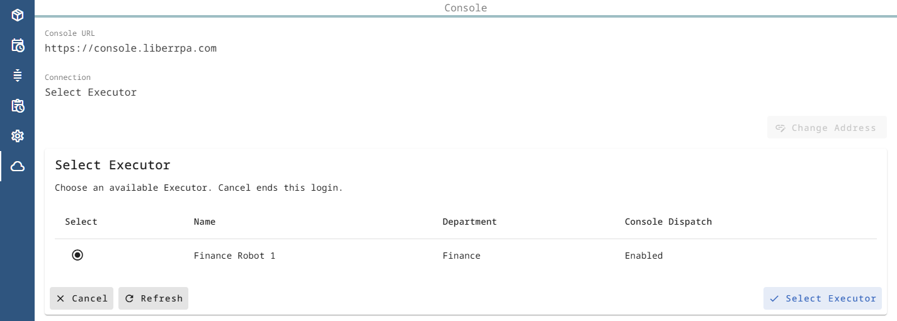
   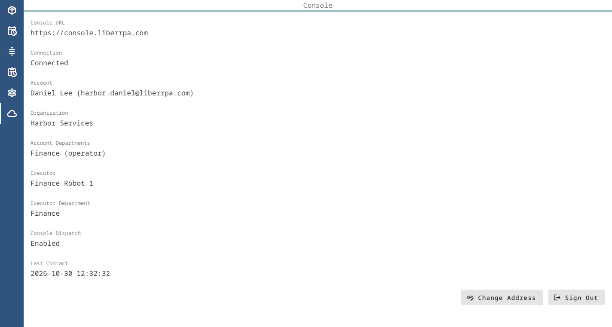

   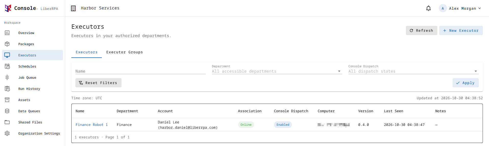
4. Create an `.rpa.zip` Package with [Project Manager](../vscodeExtensions/liberrpa-project-manager/README.md). Publish it directly to Console or upload it through `Packages` in the same department.
5. Select the Project and version, check its `Settings`, and click `Run`. Choose the Executor, review the arguments, and submit.
   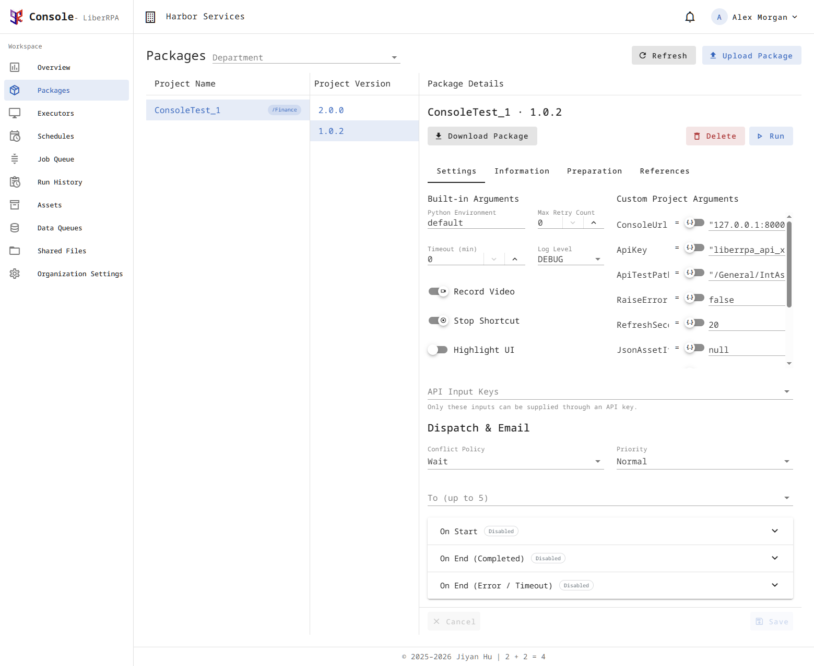

   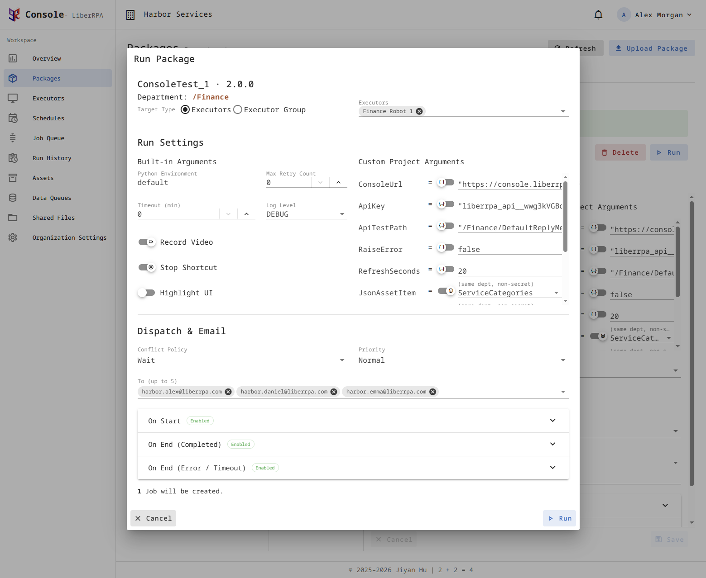
   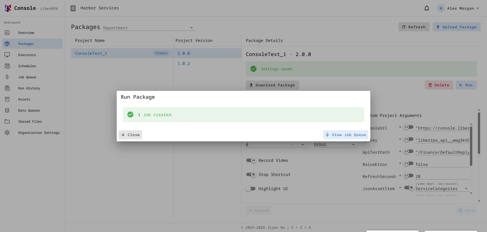
6. Follow the Job in `Job Queue`, then open `Run History` to inspect its result, logs, inputs, and outputs.
   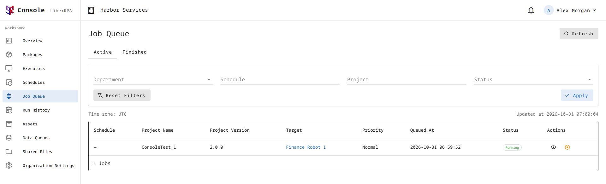
   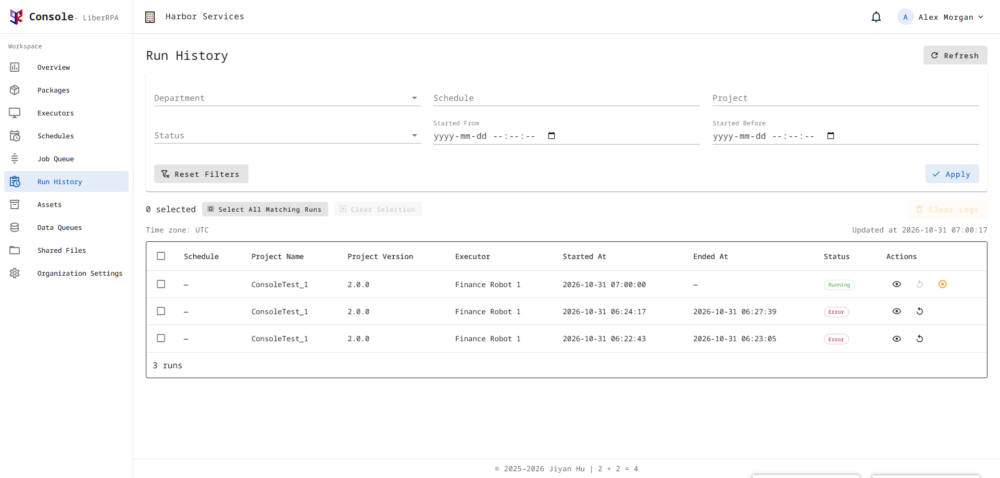

For Projects that use Assets, Data Queues, or Shared Files during development, sign in through Project Manager's `Console` page before starting a new Python run. Browser sign-in alone does not connect Editor or Executor.

## Organizations and Department Access

An organization has its own members, departments, Executors, Packages, and shared resources. Departments control which resources each member can use.

| Role          | Main purpose                                                                                            |
| ------------- | ------------------------------------------------------------------------------------------------------- |
| `Operator`  | Run Packages, manage day-to-day execution, and use department resources.                                |
| `Developer` | Operator actions plus managing resources such as Packages, Schedules, Executors, and Asset definitions. |
| `OrgAdmin`  | Manage the organization and its members, with access to every department.                               |

`Operator` and `Developer` roles are assigned separately for each department. Access to a parent department does not automatically include its children. Your available pages and actions reflect your current access.

## Overview

`Current Runs` shows running work, its Executor, start time, and elapsed time. Filter by department or Project, refresh manually, or enable `Auto Refresh`.

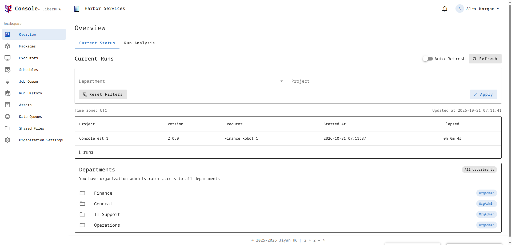

`Run Analysis` summarizes ended Runs for the selected period. It includes result counts, total run time, daily activity, and a breakdown by Executor. These statistics use retained Run records; deleted records are no longer included.

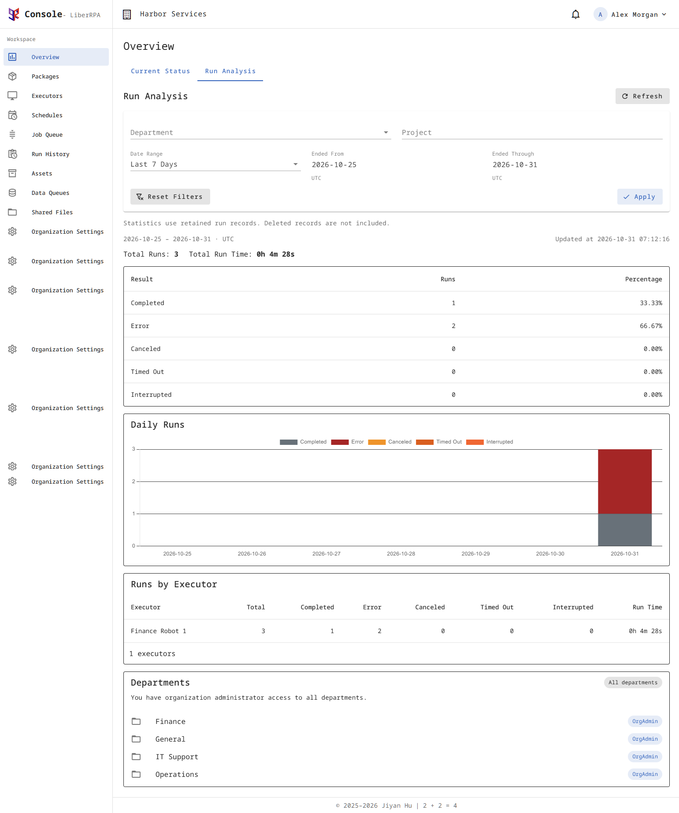

## Packages

Upload `.rpa.zip` files created by Project Manager. Each Package belongs to a department and contains one Project version. Select a Project in the first column and a version in the second to open its details.

| Tab             | What it contains                                                                                               |
| --------------- | -------------------------------------------------------------------------------------------------------------- |
| `Settings`    | Python environment, default run arguments, retries, dispatch settings, API input keys, and run email settings. |
| `Information` | Information about the uploaded file and Project version.                                                       |
| `Preparation` | Package preparation reports received from Executors, including any reported errors.                            |
| `References`  | Active references that may prevent the Package from being deleted.                                             |

Use a new version when you change Project code. Uploading the same Project version to the same department cannot replace the existing Package. Run Settings can be changed without rebuilding the Package.

### Run Settings

Set `Python Environment` to the name of an environment available on the target Executors. Make sure that environment contains the libraries required by the Project on each target Executor.

Common settings include:

- `Max Retry Count`: `0` to `3` extra attempts after an execution error or timeout. Each retry waits at least one minute before it can start.
- `Timeout (min)`: the limit for each attempt; `0` means no limit.
- `Log Level`, `Record Video`, `Stop Shortcut`, and `Highlight UI`.
- `Custom Project Arguments`: values for the argument names defined in the Project, up to 100 entries.

Enter argument values as JSON. For example, use `"Example text"` for a string and `true` for a Boolean. You can also choose an ordinary, non-secret Asset from the same department as an argument's source. Duplicate argument names use the last listed value at runtime.

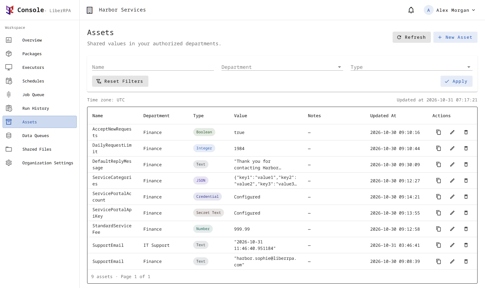

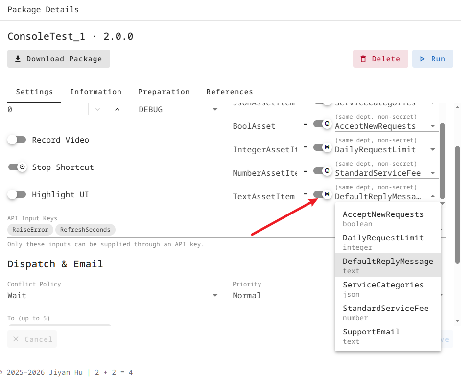

`API Input Keys` controls which custom arguments an API caller can supply.

Run email settings let you choose member addresses or verified external addresses and enable messages on start, completion, or error/timeout. They have default templates, and you can use `Insert Field` to add run information to your own text. Each actual Run, including a retry, can send its own start and end emails according to these settings. A failed email does not change the Run result. Failed or unsent messages are not retried automatically.

Save Package settings before opening `Run`. Changes made inside `Run Package` apply to that request; they do not replace the saved Package settings.

### Targets and Conflicts

Choose targets in the Package's department:

- `Executors` creates one Job for each selected Executor.
- `Executor Group` creates one Job for an eligible member of the selected group.

Targets must be available for Console dispatch. When eligible Executors are busy, `Conflict Policy` determines what happens:

| Policy               | Behavior                                                  |
| -------------------- | --------------------------------------------------------- |
| `Skip This Run`    | Skip the work when no eligible Executor is free.          |
| `Wait`             | Wait for an eligible Executor to finish its current work. |
| `Run Concurrently` | Allow the work to run alongside existing work.            |

`Wait` is for busy Executors, not for waiting for an offline computer to reconnect. Concurrent Projects share the computer, so choose this policy only when their work can run together.

`Priority` controls the order of eligible waiting Jobs. It does not interrupt Runs already in progress.

## Executors

An Executor record represents an Executor client connected to Console. The list shows its department, associated account, connection state, and dispatch state.

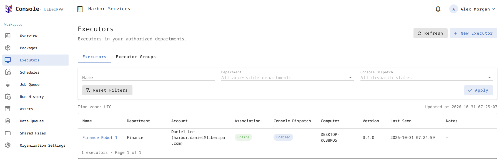

Click its name for computer details and the last reported work.

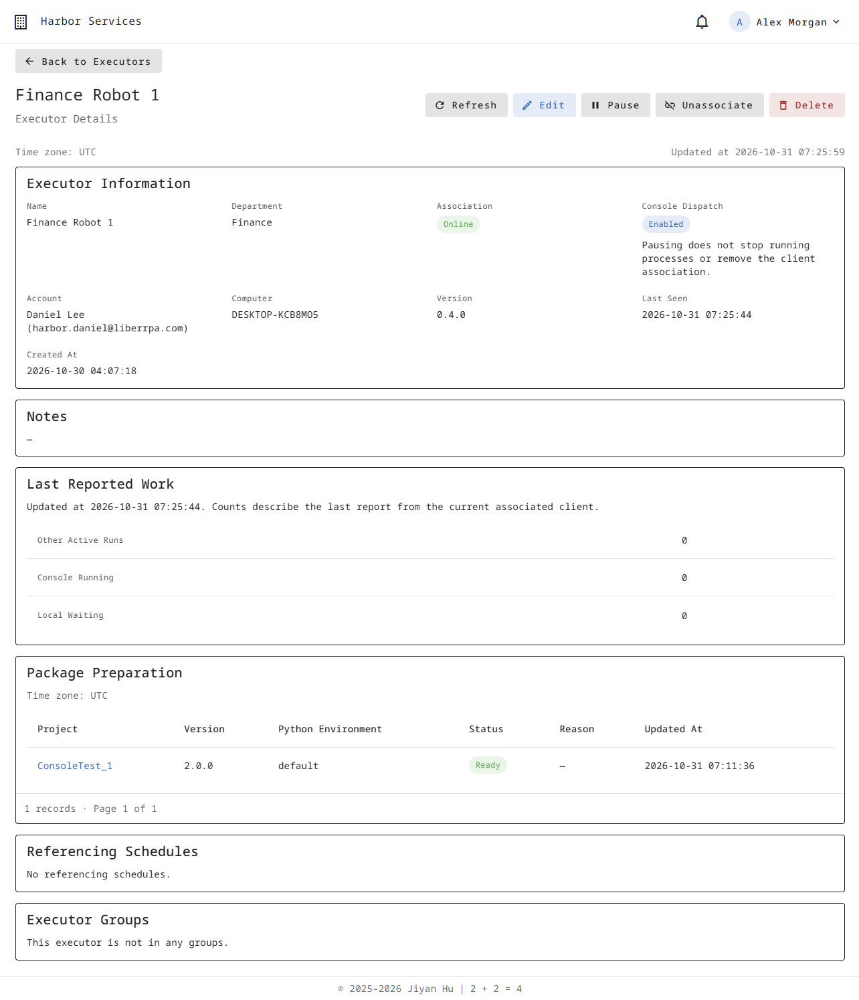

Use `New Executor` to create a record before selecting it in the desktop client. A client association connects that record to a signed-in Executor.

During a Run, the Project accesses Console resources using the account signed in to the Executor. Make sure that account can access the resources the Project needs.

- `Pause` prevents new Console dispatches to the Executor. It does not stop running processes or remove the association.
- `Resume` allows Console dispatch again.
- `Unassociate` releases the record from its current client. Use it when replacing the client or correcting an association.
- `Edit` changes its name and notes. The department is fixed when the record is created.

The `Executor Groups` tab lets you manage groups within a department. A group provides a choice of Executors for a Job; it does not run the same Job on every member.

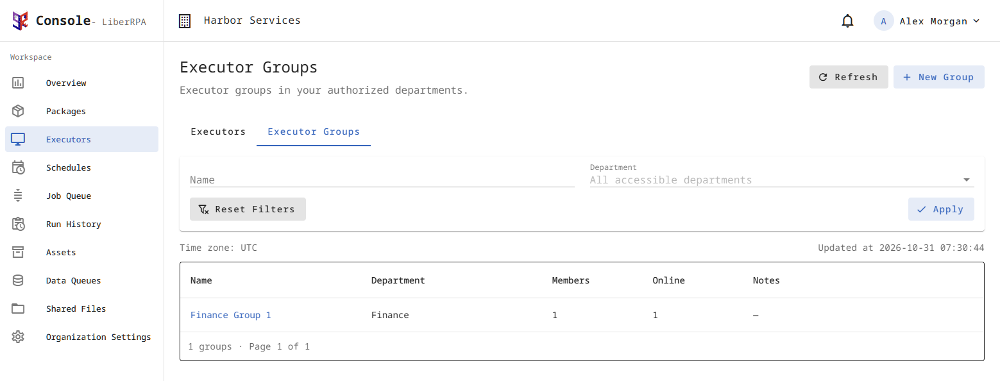

For local execution and local schedules, see the [Executor guide](../electronApplications/executor/README.md).

## Schedules

Use `New Schedule` to run a Package at set times. Choose its department, Project version, targets, conflict policy, priority, active period, and run settings.

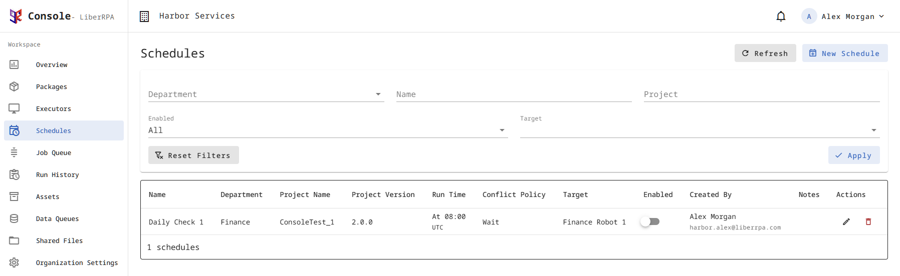

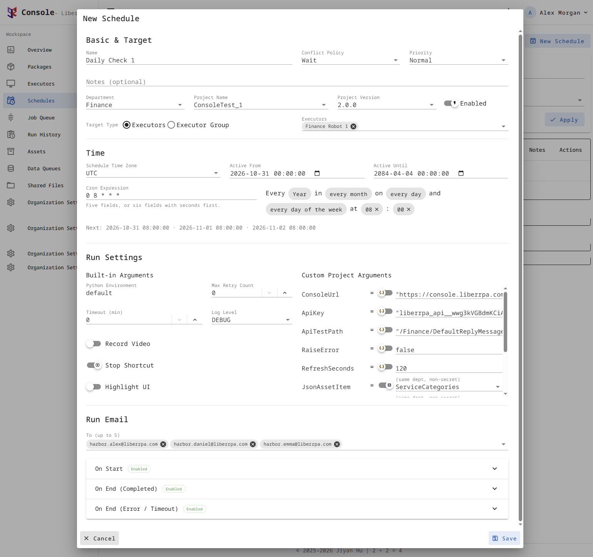

Check `Schedule Time Zone` before entering times. A new Schedule starts with your personal time zone. Changing your profile time zone later does not change an existing Schedule's time zone.

Cron expressions accept five fields, or six fields with seconds first. For example:

```text
0 9 * * 1-5
```

This runs at 09:00 from Monday through Friday in the Schedule's time zone. Check the previewed trigger times before saving.

Selecting a Package version supplies initial run settings. Saved Schedules keep their own arguments and dispatch settings; later changes to Package defaults do not automatically replace them. The Python environment comes from the Package settings.

Use `Enabled` to control future triggers. Editing, disabling, or deleting a Schedule does not change Jobs already accepted by Console, including waiting work and retries. Use `Job Queue` to cancel or stop those Jobs separately.

## Job Queue

A **Job** is a request to run a Package. A **Run** is an actual execution attempt on an Executor. A Job can have several Runs when retries are enabled, or no Runs if it never starts.

A Job keeps the version, Python environment, settings, and input values captured when Console accepts it, including values taken from Assets. Later changes do not update those saved values. Each retry starts the whole Flow again with the original inputs; it does not undo work already completed in other applications. Enable retries only when the Project can safely repeat its steps. For a group target, a retry may run on another eligible member.

`Job Queue` shows dispatch and control progress, including `Waiting`, `Preparing`, `Starting`, `Running`, `Waiting for Retry`, and `Needs Review`. Open a Job to inspect its target, inputs, Runs, and events. A `Finished` Job is no longer active; check the Run result or Job reason to see what happened.

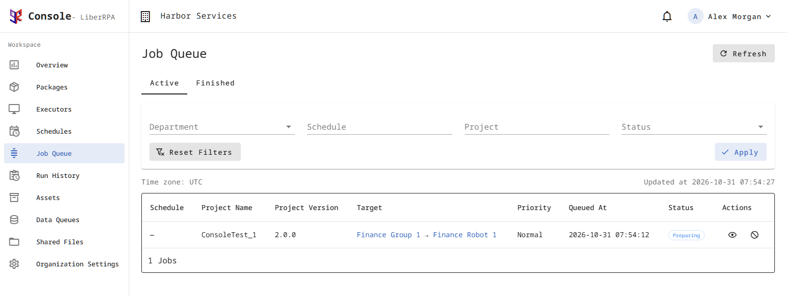

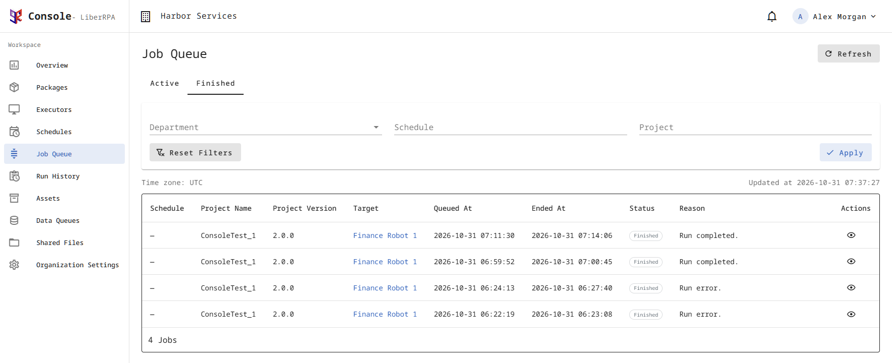

Available actions depend on the current state:

- `Cancel` cancels work that has not started.
- `Cancel Retries` cancels the remaining attempts while waiting for a retry.
- `Stop` requests that the active work stop. Check the resulting status; a submitted request is not confirmation that the process has ended.
- `Close Job` ends Console's management of a Job and cancels future attempts when its result cannot be confirmed. The process may still be running on the Executor.

For `Needs Review`, read the reason and check the Executor before closing the Job or starting replacement work.

## Run History

Filter Runs by the available department, Project, Executor, time, and result filters. Open a Run to view:

- `Logs`: recorded messages and the available log download.
- `Inputs`: the settings and arguments used for this Run.
- `Outputs`: the final Custom Project Argument values captured when the main Flow ends. Missing outputs do not by themselves mean that the Run failed.
- `Details`: Job information, error details, other attempts, and available video and subtitle downloads.

Logs already uploaded to Console remain available when the Executor is offline.

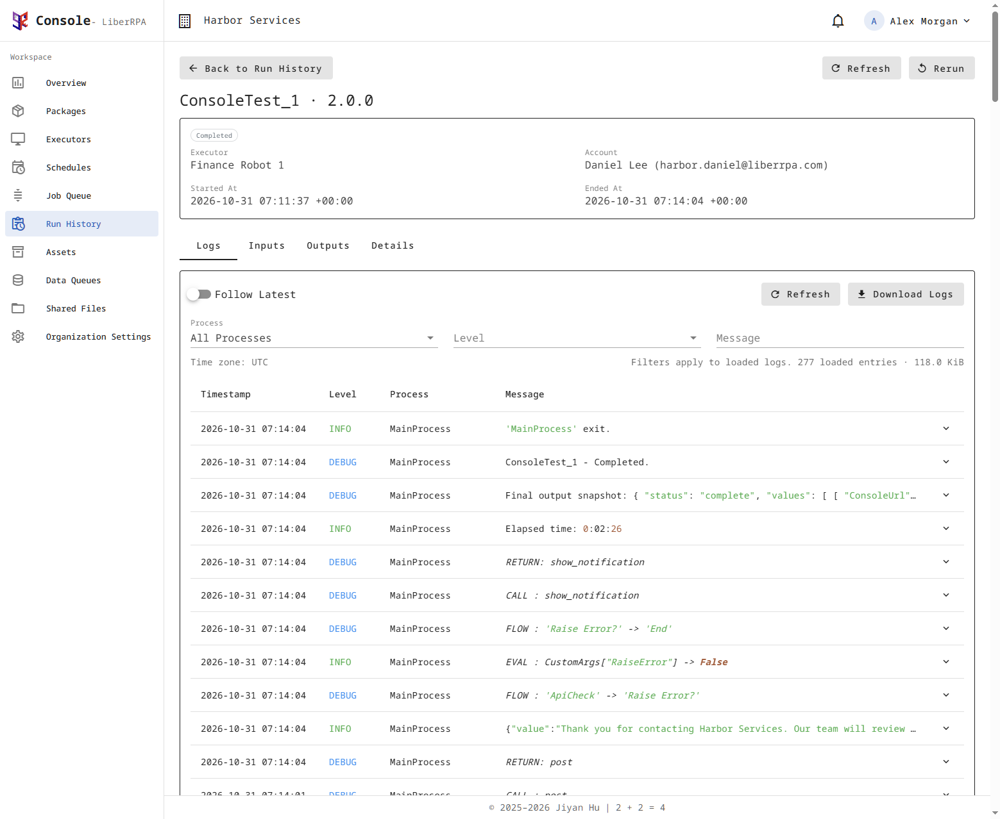

`Download Logs`, video, and subtitle downloads use files from the original Executor after the Run's process has exited. Keep that client connected with its original association; the page explains when a download is unavailable.

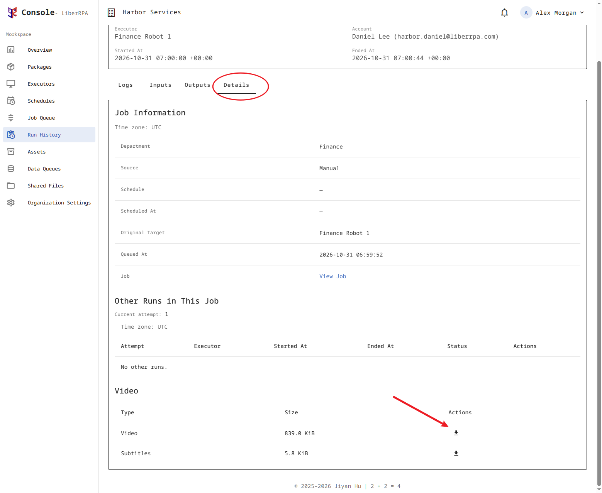

Select Runs in `Run History` and choose `Clear Logs` to remove their logs from Console. Run records, inputs, outputs, and files on Executors are kept. Runs whose Jobs are still active or need review are skipped.

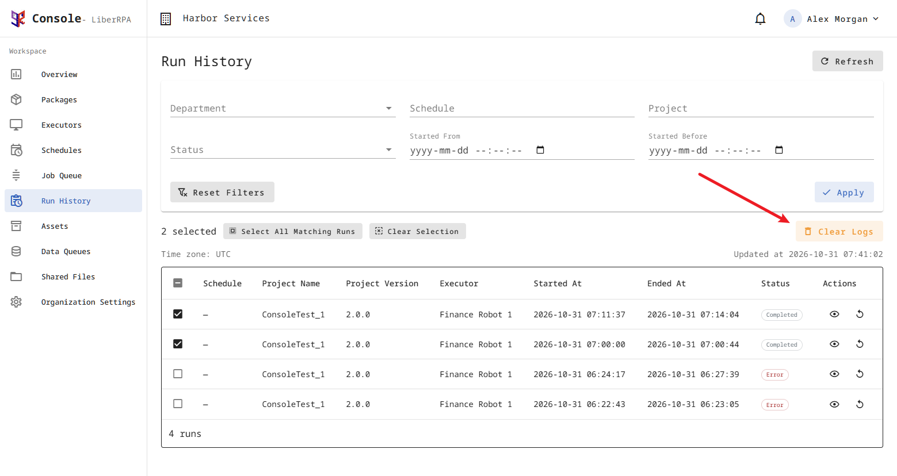

`Rerun` opens a new request using the most recently uploaded Package for that Project in the same department. Check its version, settings, and targets before submitting. It does not replay the historical Run unchanged. Console must first confirm that the original process has exited. Check any warning about work still pending in the original Job. Rerun does not cancel that work.

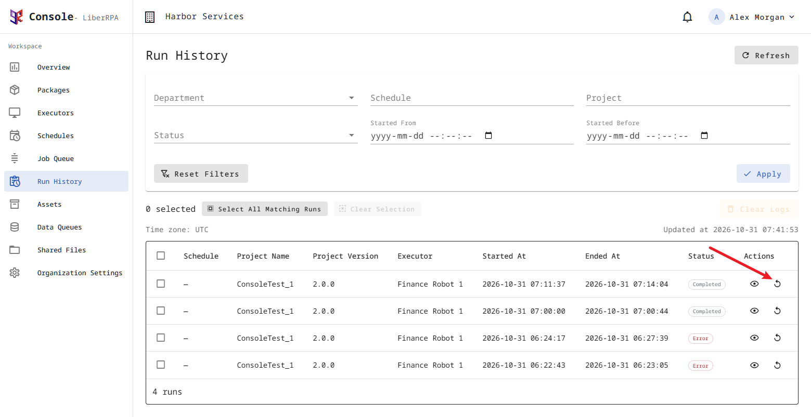

## Assets

Assets hold reusable values such as URLs, settings, secrets, and credentials. Each Asset has a name, type, and department.

Developers manage Asset definitions and secret values. Operators can use Assets and update ordinary values where permitted. Secret Text and Credential values are handled separately from ordinary values and are not offered as Custom Project Argument sources.

Stored secret values are not shown in the browser. To change one, enter its complete replacement value.

Use the full Asset path when accessing it from Python. See the [Console Python reference](../docs/Reference.md#console) for reading values, secrets, and credentials, and for updating ordinary values.

## Data Queues

Data Queues hold items for Projects to pick up and process. Developers create and manage queues; Operators can work with their items.

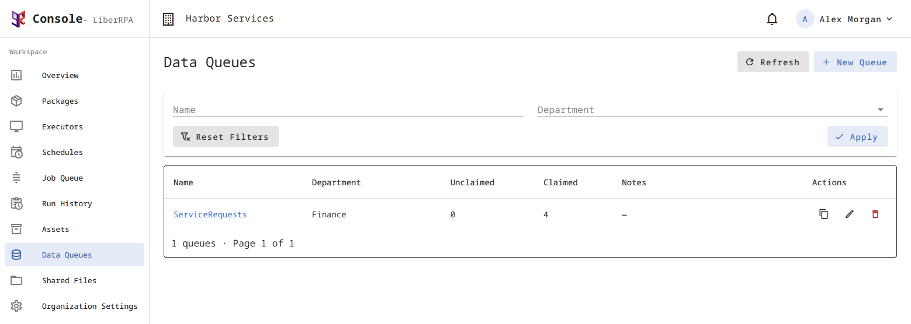

Open a queue to filter and inspect items, upload data, reset selected items, or delete them. The upload dialog supports spreadsheets, delimited text, JSON, and JSON Lines, with a preview to check the data before submission.

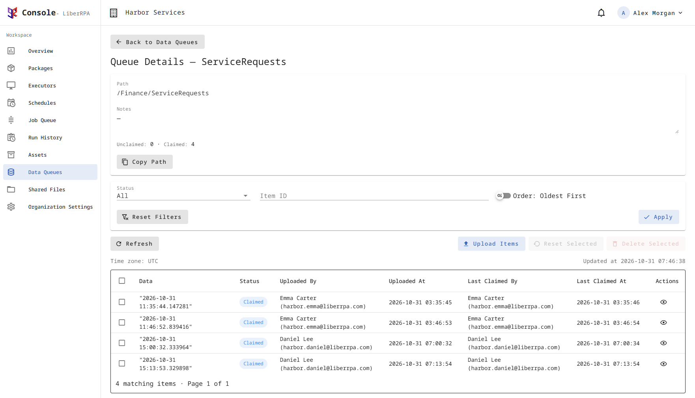

Items are `Unclaimed` or `Claimed`. By default, Projects claim only Unclaimed items, so workers do not pick the same item as new work. `Claimed` does not mean that processing succeeded. A Run ending or failing does not automatically reset its items. Before resetting an item, check that the original Project is no longer processing it; resetting does not stop that Project.

For Python queries, uploads, claims, resets, and deletion, see the [Console Python reference](../docs/Reference.md#console).

## Shared Files

Use `Shared Files` to upload, download, and remove files in your authorized departments. Projects can use the same files through Python.

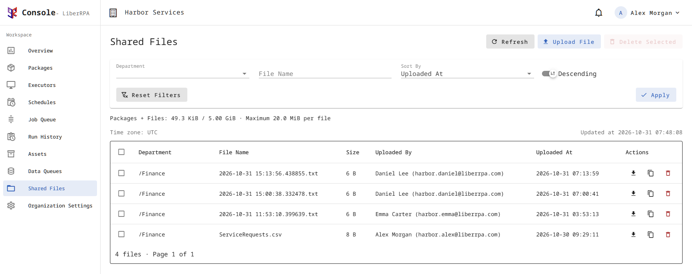

Check the target department when uploading. Copy the file's full path for use in your Project. Shared Files and Packages use the same organization storage allowance; uploads are also subject to a single-file size limit.

Enable `Overwrite Existing File` to replace a file with the same name. Successful replacements do not keep previous versions.

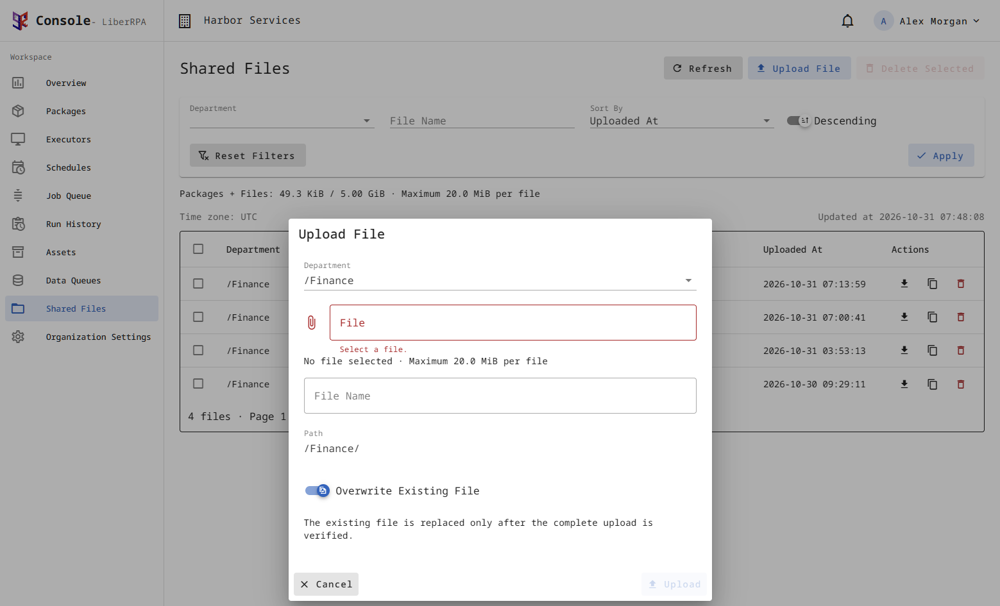

The [Console Python reference](../docs/Reference.md#console) describes listing files, reading file information, uploading, downloading, and deleting.

## Organization Settings

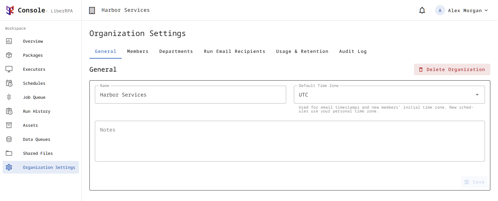

This section is available to `OrgAdmin` accounts.

| Page                     | Main tasks                                                                                                       |
| ------------------------ | ---------------------------------------------------------------------------------------------------------------- |
| `General`              | Change the organization name, default time zone, and notes; request organization deletion.                       |
| `Members`              | Invite members, manage department roles and organization administrators, and manage member accounts.             |
| `Departments`          | Create and organize departments, view assigned members, and open department resources.                           |
| `Run Email Recipients` | Use member email addresses and add verified external recipients for run email.                                   |
| `Usage & Retention`    | Check resource usage and limits, change Run Log Retention, and view Run History and Audit Log retention periods. |
| `Audit Log`            | Review recorded actions in the organization and inspect their details.                                           |

The organization's `Default Time Zone` is used for email timestamps and new members' initial time zone. Existing users control their own display time zone in `My Profile`.

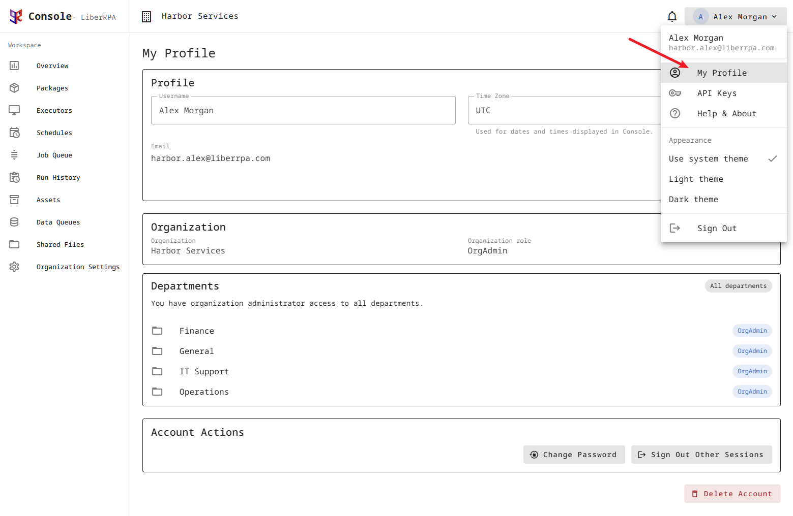

If a member cannot see a resource, check the resource's department and that member's role there.

**Renaming or moving a department also changes the paths of its resources and subdepartments. Update any affected paths in your Project code, arguments, and templates.**

Shortening `Run Log Retention` can remove older Run logs. Save any logs you need before lowering it. Capacity limits may also remove eligible logs and history before their retention periods end; removing Run History records affects Run Analysis statistics.

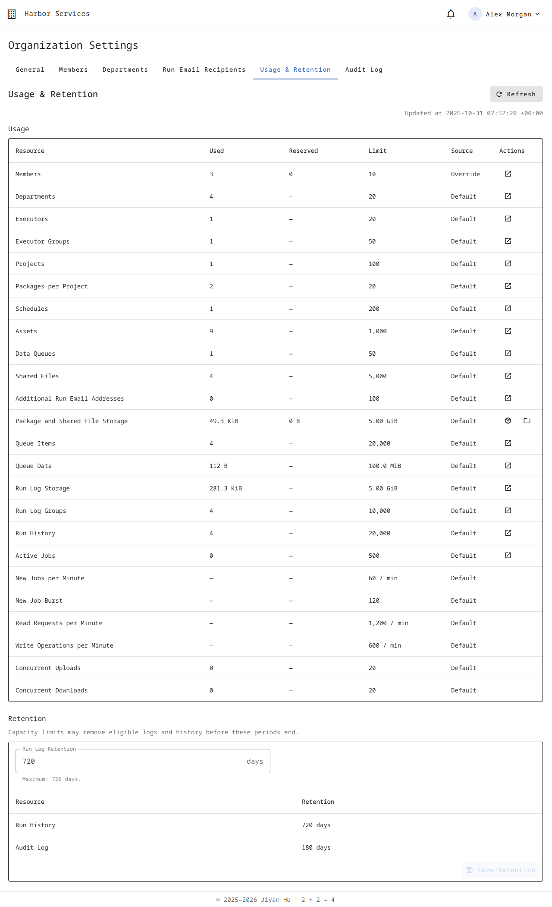

Requesting organization deletion makes its business operations unavailable immediately. The confirmation and status pages show the remaining recovery period and whether deletion can still be canceled.

## Notifications and Account Settings

The notification bell shows messages that need your attention. Opening a message shows its details and marks it as read. You can also mark all messages as read, delete individual messages, or clear the list.

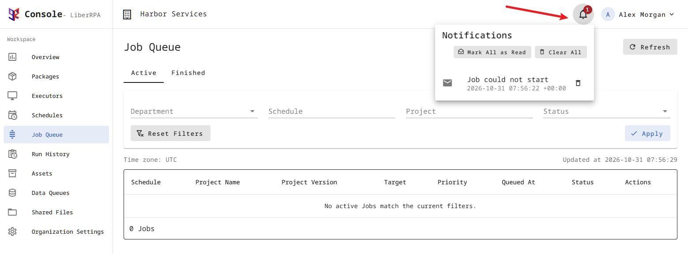

Open the account menu for:

- `My Profile`: change your username and display time zone, view department access, change your email or password, use `Sign Out Other Sessions`, or delete your account.
- `API Keys`: create keys with an expiry time and revoke keys you no longer need. Copy a new key when it is shown; its secret cannot be viewed again. Keys allow `Operator` actions in the departments your account can currently access, even if your browser account has a higher role.
  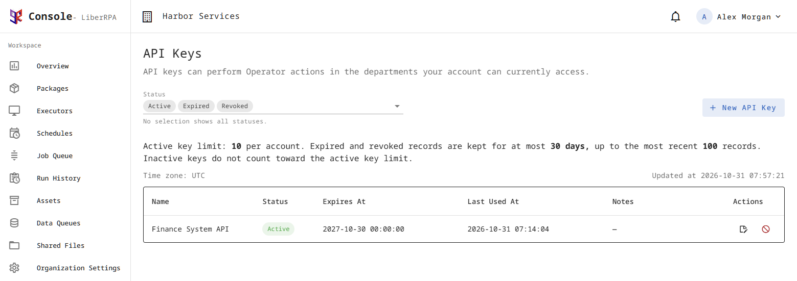
- `Help & About`, appearance settings, and `Sign Out`.

Changing or resetting your password signs out all browser, Editor, and Executor sessions and revokes active API keys. `Sign Out Other Sessions` keeps this browser session and your API keys, but signs out other browsers and all Editor and Executor sessions. Affected Executors must sign in and select an Executor record again.

On a shared computer, leave `Remember me` unchecked and sign out when finished. Browser sign-out also ends the session in the other tabs of that browser.
