# LiberRPA Executor

**LiberRPA Executor** is the local runtime manager for Flow Project Packages created by [LiberRPA Project Manager](../../vscodeExtensions/liberrpa-project-manager/README.md).

Executor installs versioned `.rpa.zip` Packages and manages:

- per-version Run Settings and Custom Arguments;
- manual Runs and automatic retries;
- Cron-based Schedules;
- Skip, Wait, and Concurrent conflict policies;
- the Job Queue and Run History;
- work sent from [LiberRPA Console](../../djangoConsole/README.md);
- cancellation, timeouts, logs, recording, and retention;
- an optional Windows RDP Session helper.

Executor does not edit source Projects or resolve Component dependencies. Those operations belong to LiberRPA Editor and Project Manager.

> **Note:**
>
> Screenshots and animations in this document are provided for reference. As LiberRPA evolves, the current interface may differ slightly in appearance or wording, but these minor differences do not affect the documented workflow or functionality.

## Contents

- [Requirements](#requirements)
- [Package Model](#package-model)
- [Main Workflow](#main-workflow)
- [Connect to Console](#connect-to-console)
- [Settings](#settings)
- [Logs and Recording](#logs-and-recording)
- [Example](#example)
- [Data and Recovery](#data-and-recovery)
- [Known Issues](#known-issues)

## Requirements

Run [`InitLiberRPA.exe`](../../docs/Installation.md#initialize-liberrpa) before using Executor. Initialization registers the active LiberRPA root, creates the required user-level data and authentication files, and creates the Executor shortcuts.

The official release already contains the [standard Python environment](../../docs/Environment.md). Executor discovers available environments under:

```text
%LiberRPA%\envs\pyenv\
```

The `default` environment must contain `python.exe`. A custom environment must also contain `python.exe`, use the same `liberrpa` version as `default`, and provide any additional third-party dependencies required by the Project.

Use Packages created by [LiberRPA Project Manager](../../vscodeExtensions/liberrpa-project-manager/README.md#package-a-flow-project). If Executor shows a version compatibility warning, check that the Package works with your installed LiberRPA version.

Executor is Windows-only. Run it as administrator only when:

- a Project must interact with applications running with administrator privileges; or
- `Keep RDP Session` is enabled.

## Package Model

Project Manager creates deployment Packages named like:

```text
<ProjectName>_<Version>.rpa.zip
```

The Project content is stored directly at the archive root. Executor uses the following entries as Package metadata and runtime input:

| Entry                      | Purpose                                                                                               |
| -------------------------- | ----------------------------------------------------------------------------------------------------- |
| `flow.json`              | Project name, version, description, and Component requirements recorded by the source Project.        |
| `.liberrpa-package.json` | Package metadata, including the Version Summary entered during packaging.                             |
| `project.flow`           | Initial Run Options and Custom Arguments.                                                             |
| `_Components/`           | Materialized Component packages used directly at runtime when the Project has Component dependencies. |

Component dependency resolution happens before packaging. Executor does not access the local Component Repository, resolve or repair dependencies, or rebuild `_Components`. Treat the generated Package as an immutable deployment artifact; manual changes may cause installation or execution to fail.

Installing a Package creates a managed directory under:

```text
C:\Users\<UserName>\Documents\LiberRPA\Packages\Local\<ProjectName>_<Version>\
```

Multiple versions of the same Project can coexist. Executor does not overwrite an installed name/version pair. After changing Project content, increase `flow.json.version`, create a new Package, and install the new version.

### Package Limits

Executor applies the following limits during installation:

| Item                       |   Limit |
| -------------------------- | ------: |
| `.rpa.zip` archive size  | 512 MiB |
| Total extracted size       |   2 GiB |
| Size of one extracted file | 512 MiB |
| ZIP entries                |  20,000 |

Packages should primarily contain Project code, packaged Components, and reasonably sized runtime resources. Large models, videos, datasets, and other heavyweight resources should normally remain in dedicated storage and be referenced through Project configuration or an absolute storage path.

## Main Workflow

### Window and Tray

Closing the Executor window hides it in the Windows notification area; it does not stop Executor. Schedules, Job Queue processing, active Runs, Console connections, and retention checks continue while the tray process is running.

Use the tray menu to:

* `Show` the Executor window;
* `Exit` Executor and perform the normal shutdown sequence.

Clicking the tray icon also toggles the window between shown and hidden.

### Install a Package

1. Open `Packages`.
2. Click `Install Package`.
   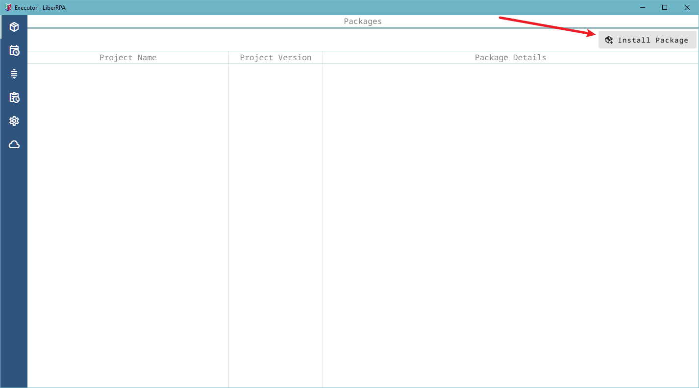
3. Select an `.rpa.zip` created by LiberRPA Project Manager.
4. After installation, Executor selects the installed Project name and version automatically.
   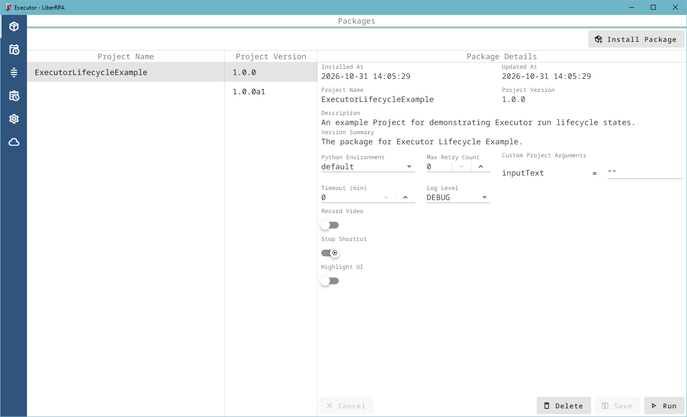

The following metadata is read-only:

- `Installed At`: when this Package version was installed in the current Executor database;
- `Updated At`: when its local Run Settings were last saved;
- `Project Name`, `Project Version`, and `Description`: from `flow.json`;
- `Version Summary`: entered when Project Manager created the Package.

Project names and versions are ordered by installation time, with the most recently installed first. Executor does not compare version numbers when ordering these lists.

### Configure and Run a Project

Each installed Project version has its own local Run Settings:

- `Python Environment`;
- `Max Retry Count`: `0` to `3` extra attempts after an execution error or timeout; `0` disables retries;
- `Timeout (min)`: the limit for each attempt; `0` means no limit; maximum `35,791` minutes;
- `Log Level`;
- `Record Video`;
- `Stop Shortcut`;
- `Highlight UI`;
- `Custom Project Arguments`, up to 100 entries.

The initial built-in Run Options and Custom Arguments come from the packaged `project.flow`. Executor displays Custom Argument names as read-only keys. Enter each value as valid JSON; for example, a string must include quotation marks:

```json
"Example text"
```

Executor preserves Custom Argument keys exactly as packaged. Duplicate keys are highlighted as a warning but do not prevent saving or running. At runtime, arguments are applied in their listed order, so the last value with the same key takes effect. Correct duplicate keys in LiberRPA Flowchart and create a new Package when necessary.

For the built-in Run Options and complete Custom Argument rules, see [LiberRPA Flowchart](../../vscodeExtensions/liberrpa-flowchart/README.md#custom-project-arguments).

Use the buttons at the bottom of `Packages`:

- `Save` stores the current local Run Settings;
- `Cancel` restores the saved settings;
- `Delete` removes the selected installed Project version;
- `Run` opens a dialog to review and change settings for this run. Changes in the dialog do not replace the saved Package defaults.

`Run` is disabled while the current settings contain unsaved changes.

A manual Run starts immediately and can run alongside other work. Before starting concurrent work, check whether the Projects share the mouse, keyboard, or other resources.

Local retries wait one minute before the next attempt. Each attempt appears separately in `Run History`. A stopped or interrupted Run is not automatically retried. Each retry starts the whole Flow again with the original inputs; it does not undo work already completed in other applications. Enable retries only when the Project can safely repeat its steps.

A Project version cannot be deleted while:

- one or more Schedules use it;
- one of its Runs is starting or running; or
- a local Job is waiting to run or retry in the Job Queue.

### Schedules

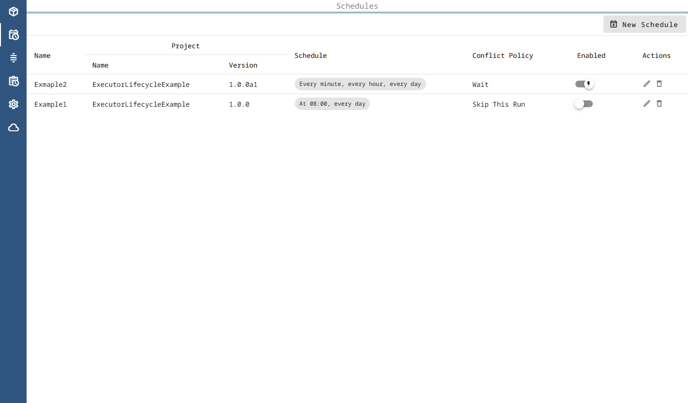

Open `Schedules` and click `New Schedule`.

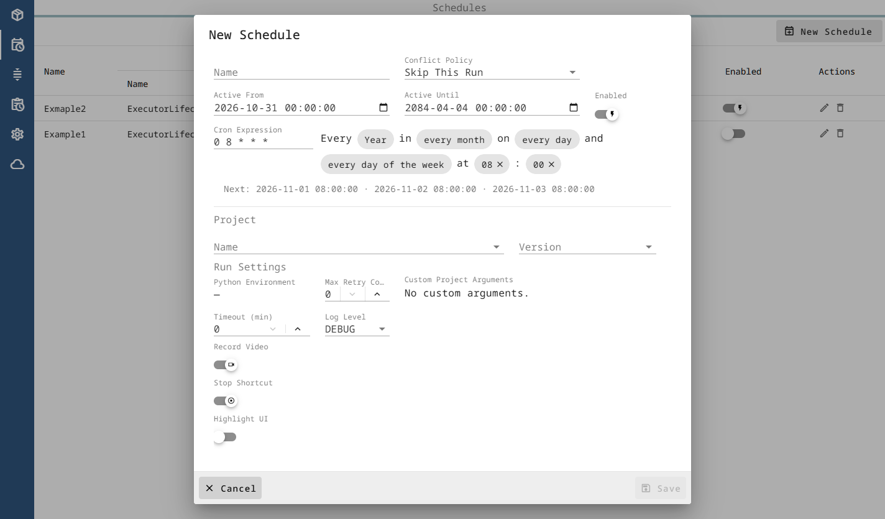

A Schedule contains:

* a unique `Name`;
* `Active From` and `Active Until`;
* an `Enabled` switch;
* a `Cron Expression`;
* a Project name and version;
* a Run conflict policy;
* its own Run Options, Max Retry Count, Timeout, and Custom Arguments.

Selecting a Project version copies its current Run Options, Max Retry Count, Timeout, and Custom Arguments into the Schedule form. After the Schedule is saved, these values belong to the Schedule and are not automatically changed when the Project Run Settings are edited later.

The Python Environment is not copied into the Schedule. A scheduled Run uses the environment currently selected for its Project version.

#### Cron Expression

Executor uses [`cron-parser`](https://github.com/harrisiirak/cron-parser) to calculate Schedule trigger times.

For common schedules, use the standard 5-field form:

```text
minute hour day-of-month month day-of-week
```

For example:

```cron
*/5 * * * *
```

runs every 5 minutes, with the omitted seconds field treated as second `0`.

The `Cron Expression` field can also use the optional-seconds 6-field form:

```text
second minute hour day-of-month month day-of-week
```

For example:

```cron
*/5 * * * * *
```

runs every 5 seconds.

The visual Cron editor is intended for common 5-field expressions. Use the text field for 5-field or optional-seconds 6-field expressions with numbers, `*`, ranges, lists, and steps. Check the description and upcoming trigger times before saving.

The Scheduler calculates the next trigger in advance and keeps only that nearest trigger as `Pending`. Due work is checked at approximately one-second intervals, so Schedule execution is not intended to provide millisecond-level timing. A Schedule generates triggers only within its `Active From` and `Active Until` period.

Cron times are interpreted using Executor's global [Time Zone](#time-zone). Schedules do not store their own time zone. The supported syntax is the same for validation and execution.

#### Run Conflict Policy

`Conflict Policy` controls what happens when a Schedule reaches its trigger time while another Run is starting or running:

| UI value             | Stored value   | Behavior                                                                       |
| -------------------- | -------------- | ------------------------------------------------------------------------------ |
| `Skip This Run`    | `skip`       | Skip this trigger. The Schedule remains enabled for later triggers.            |
| `Wait`             | `wait`       | Queue the Job and start it when no other Run is active. |
| `Run Concurrently` | `concurrent` | Start the Run immediately alongside existing Runs.                             |

#### Time Zone

Executor uses one global Time Zone for:

* displayed timestamps;
* Cron evaluation;
* `Active From` and `Active Until`;
* Pending Run calculation.

Local Schedules do not store separate time zones. Change the global Time Zone in `Settings`. The change recalculates Pending Runs but does not rewrite the stored UTC timestamps of existing Run History records.

Console Schedules have their own time zone in Console. Changing Executor's time zone does not change those Schedules.

#### Edit or Delete a Schedule

Use the icons in the `Actions` column to edit or delete a Schedule. Editing, disabling, or deleting a Schedule changes future triggers. Work already queued or running keeps its captured settings. Use `Job Queue` to cancel queued work or stop an active Run when needed.

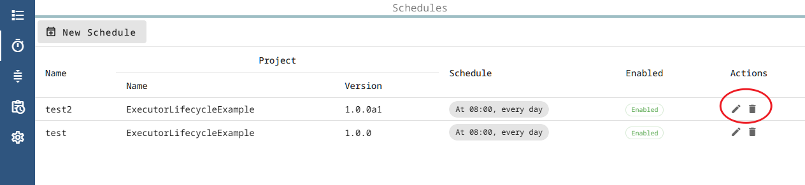

### Job Queue

A **Job** is a request to run a Project. A **Run** is one actual attempt. Retries can produce several Runs for the same Job.

The page has two sections:

| Section               | What it shows                                                                        |
| --------------------- | ------------------------------------------------------------------------------------ |
| `Current Jobs`      | Local waiting work and retries, plus active local and Console Runs on this computer. |
| `Upcoming Triggers` | The next trigger for each enabled local Schedule.                                    |

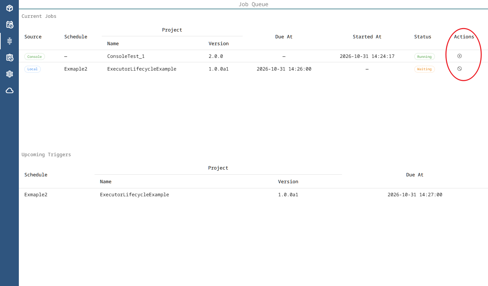

The `Source` column distinguishes `Local` and `Console` work. Use `Cancel` for waiting local work, `Cancel Retries` while waiting for a retry, or `Stop` for a running attempt.

The desktop queue does not show the whole organization's Console queue or Console's future retries. Use the browser to manage the full Console Job. Stopping a Run is separate from canceling work that Console has not yet sent to this computer.

Local waiting work and pending retries are cleared when Executor exits. Upcoming local triggers are calculated again at startup. Local schedule times missed while Executor was not running are not replayed.

### Run History

The `Run History` page displays manual and scheduled Runs, including work sent from Console. Each attempt has its own row, with its duration, source, and attempt number.

- Type in the filter fields below `Schedule`, `Project Name`, or `Project Version`, or select a `Status` or `Source`. Clear a value to remove that filter.
- Click a sortable column heading to change the sort order.
- Use the table footer to choose `15`, `50`, or `100` rows per page and move between pages.

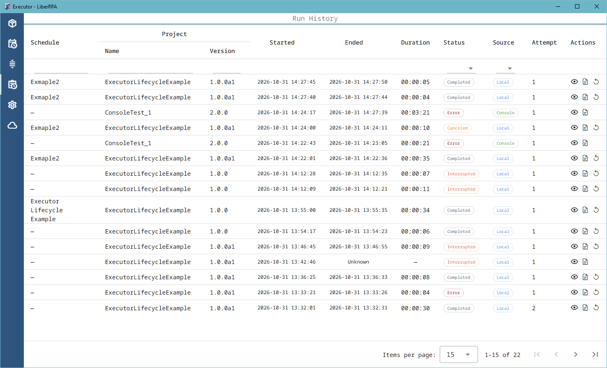

Run History stores a snapshot of the Schedule name, Project name, Project version, and Python Environment used by the Run. History remains available after the corresponding Project or Schedule is deleted.

| Status          | Meaning                                                                                                                                                                                                                                                  |
| --------------- | -------------------------------------------------------------------------------------------------------------------------------------------------------------------------------------------------------------------------------------------------------- |
| `Running`     | The Project Python process is active.                                                                                                                                                                                                                    |
| `Completed`   | The Project published successful completion and its Python process exited normally.                                                                                                                                                                      |
| `Error`       | The Project reported an execution error.                                                                                                                                                                                                                 |
| `Canceled`    | The user canceled the Run, or Executor terminated it during a normal shutdown.                                                                                                                                                                           |
| `Timed Out`   | The Run exceeded its configured Timeout.                                                                                                                                                                                                                 |
| `Interrupted` | The Python process exited unexpectedly, or Executor could not recover the final result after restarting. `Ended` is recorded when Executor detects the process exit; it may be `Unknown` when recovering a Run after an unexpected Executor shutdown. |
| `Unknown`     | A Console Run's final result has not been confirmed after recovery. Check the Job and the computer.                                                                                                                                                      |

Available actions include:

* `View Run Details` to inspect the settings and initial arguments under `Inputs`, and final argument values under `Outputs`. The dialog also shows missing-output reasons and error information when available;
  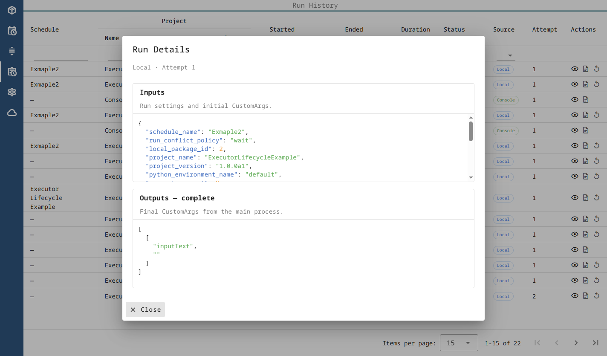
* `Open Log Folder` for the selected Run;
* `Stop Run` while the status is `Running`;
* `Run Most Recently Installed Version` to open a new run dialog for an ended local Run with a confirmed end time.
  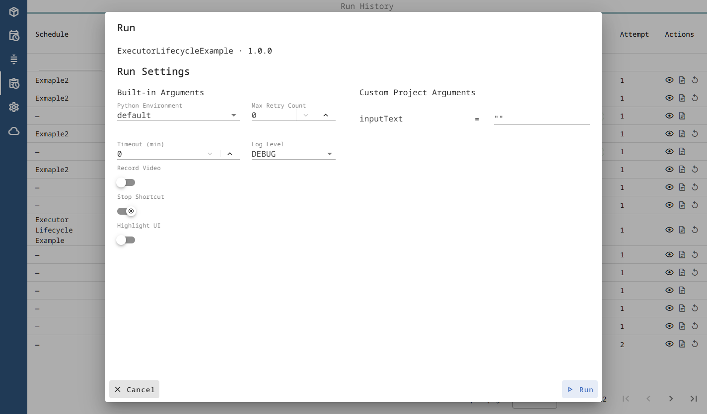

`Run Most Recently Installed Version` selects by installation time, not by version-number comparison. Review the selected version and settings before starting. For Console work, use `Rerun` in the browser instead.

## Connect to Console

Use the free public service at [console.liberrpa.com](https://console.liberrpa.com). If your organization hosts its own Console, use that address instead.

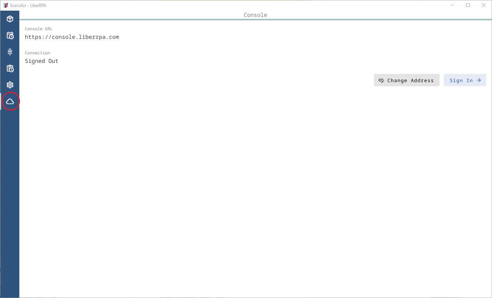

You need an organization account with access to the required department and an available Executor record in that department. Create your organization or accept an invitation in the browser first. Executor records are created through `Executors > New Executor`.

1. Open Executor's `Console` page and click `Change Address`.
2. Enter the Console URL and click `Validate and Save`.
3. Click `Sign In` and enter your account's email and password.
4. Under `Select Executor`, choose the record for this computer and confirm with `Select Executor`.
   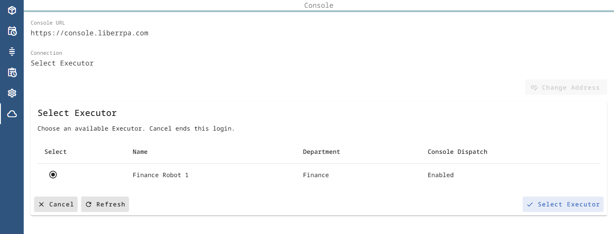
5. Check the account, department, connection state, and `Console Dispatch` status.
   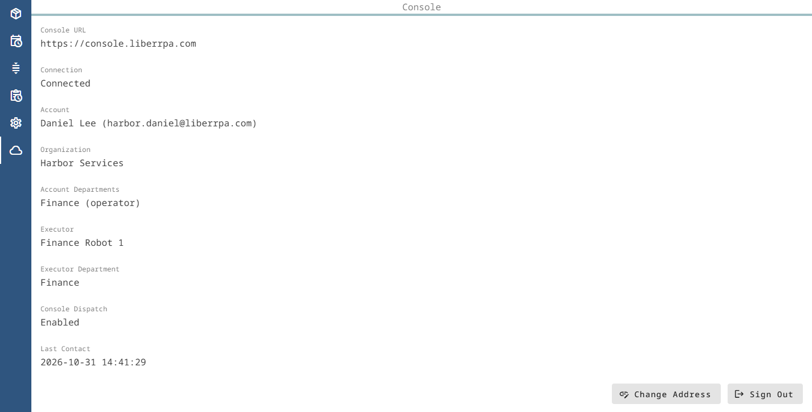

If no record is available, create one or release the old association through Console, then refresh the list. On a privately hosted server, the computer must trust its HTTPS certificate; ask the service administrator to follow the [deployment guide](../../djangoConsole/DEPLOYMENT.md#configure-https).

Executor downloads the required Package from Console and runs it on this computer. Prepare the named Python environment and the applications the Project needs on this computer.

Projects access Console resources using the account signed in to this Executor. Check that account's department access, even when someone else submits the Job in the browser.

`Console Dispatch` can be paused or resumed in the browser. Pausing prevents new Console dispatches; it does not stop active processes or local schedules.

Wait for actual Runs to finish, or stop them, before signing out or changing the Console address. Changing the address requires signing in again. Browser sign-in and Executor sign-in are separate.

For central scheduling, shared resources, and Job management, see the [Console user guide](../../djangoConsole/README.md).

The `Packages` and `Schedules` pages in Executor manage local work. Signing in does not upload local Packages or Schedules to Console. Packages received from Console are kept separately from local installations.

Local work can run without Console. If a local Project uses Console Assets, Data Queues, or Shared Files, sign in before starting it and keep Console reachable.

## Settings

Executor stores its local configuration in:

```text
%LiberRPA%\configFiles\Executor.jsonc
```

Most Settings are saved automatically. See [Retention](#retention) for settings that require `Apply`.

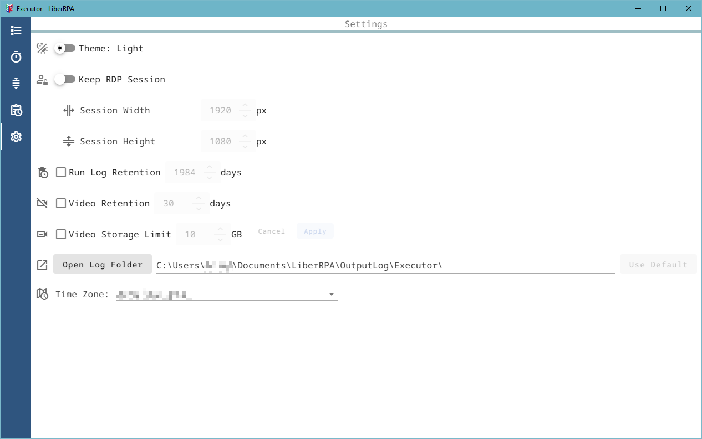

### Appearance

Switch between the Light and Dark themes.

### Project Log Folder

The Project Log Folder is the root used for future Run logs.

* Click the path field to select another existing folder.
* Click `Open Log Folder` to open the effective folder.
* Click `Use Default` to follow the `outputLogPath` resolved from `configFiles/basic.jsonc` for Executor.
* Changing this setting does not move existing Run logs.

### Time Zone

Select the global IANA Time Zone used by Executor. A new configuration initially uses the current Windows system time zone when it is available, otherwise `UTC`.

### Keep RDP Session

`Keep RDP Session` is a best-effort Windows helper. After an RDP connection is disconnected, Executor attempts to keep the GUI Session usable, restore the configured resolution for the primary/default display device, and make a minimal mouse movement after 30 seconds of inactivity.

Executor must run as administrator for this option. Behavior may depend on the Windows Session type, display driver, RDP client, and whether multiple users are active. It cannot prevent every type of Session lock.

`Session Width` and `Session Height` configure the target primary/default display resolution after the RDP connection is disconnected. Other displays are not reconfigured by Executor.

### Retention

Retention fields do not change the saved configuration until you click `Apply`. Click `Cancel` to restore the currently saved values. Enabling cleanup or lowering an active threshold displays a confirmation because future cleanup may permanently delete existing logs or videos.

Applying the settings does not start cleanup immediately. Executor checks retention when it starts and every hour while it remains running. Active Runs are excluded.

- `Run Log Retention` deletes complete Run log folders older than the configured number of days. Minimum: 7 days.
- `Video Retention` deletes Run videos and subtitles older than the configured number of days. Minimum: 1 day.
- `Video Storage Limit` keeps newer videos within the configured total size and deletes older videos and their subtitles after the limit is exceeded. Minimum: 1 GiB.

These rules affect local files from both local and Console Runs. Console has its own server-side retention settings. If local logs are removed before they can be uploaded, Console cannot receive them later.

## Logs and Recording

### Project Run Logs

The Project Python process and `liberrpa` write the normal Project logs, including:

```text
human_read_*.log
machine_read_*.jsonl
```

When `Record Video` is enabled, the Run log folder may also contain:

```text
video_record.mkv
video_record.srt
```

The subtitle file is generated from the human-readable Project log when the required entries are available. Recording captures the primary monitor and is provided by LiberRPA Local Server. The recording may need a short time to finish saving after the Run ends. See [Execution Recording](../../docs/LocalServer.md#execution-recording) for the recording lifecycle and limitations.

Use `Run History > Open Log Folder` to inspect a specific Run, or `Settings > Open Log Folder` to open the Project Log Folder root.

Console Runs also report their results and logs to Console. Video and subtitle downloads depend on the files remaining available on the Executor. Keep the Executor connected when those files are needed.

> **Logging and sensitive information:**
>
> Project logs intentionally include information useful for troubleshooting. `DEBUG` and `VERBOSE` logging can include function calls, Flow transitions, and initial Custom Argument values.
>
> A less verbose Log Level is not a guarantee that sensitive values will be omitted. Balance diagnostic detail against confidentiality requirements, restrict access to logs and recordings, and inspect them before sharing. Stricter requirements may require customizing the relevant logging statements. See [Flowchart Log Level](../../vscodeExtensions/liberrpa-flowchart/README.md#log-level).

### Executor Diagnostic Log

Executor writes its own diagnostic log below the Built-in Tools output path resolved from `configFiles/basic.jsonc`:

```text
<outputLogPath>/_Executor/YYYY-MM-DD.log
```

When a Run starts, the log records its Project name, version, full Run ID, and Python process ID. Limited output tails are recorded only for lifecycle failures that the Project logging system may not have captured, such as failure to publish the initial Run state or an unexpected process exit.

## Example

A ready-to-install Package is available at:

[`ExecutorLifecycleExample_1.0.0.rpa.zip`](./Example/ExecutorLifecycleExample_1.0.0.rpa.zip)

See [Executor Lifecycle Example](./ExecutorLifecycleExample.md) for a walkthrough covering Package installation, common Run outcomes, Schedules, the Job Queue, Run History, and logs.

The example is interactive and intended for learning and testing, not unattended production use.

## Data and Recovery

### Data Locations

| Data                        | Location                                                     | Notes                                                                |
| --------------------------- | ------------------------------------------------------------ | -------------------------------------------------------------------- |
| Executor configuration      | `%LiberRPA%\configFiles\Executor.jsonc`                    | Theme, Time Zone, log folder, RDP, and retention settings.           |
| Operational database        | `%USERPROFILE%\Documents\LiberRPA\AppData\ExecutorData.db` | Installed Project metadata, Schedules, and Run History.              |
| Installed local Packages    | `%USERPROFILE%\Documents\LiberRPA\Packages\Local\`        | Managed extracted Package versions.                                  |
| Console Packages            | `%USERPROFILE%\Documents\LiberRPA\Packages\Console\`      | Packages downloaded from Console.                                    |
| Temporary Run state         | `%USERPROFILE%\Documents\LiberRPA\ExecutorRunState\`       | Coordination files for active Executor-managed Runs.                 |
| Project logs and recordings | Configured Project Log Folder                                | Stored separately from the Executor database and installed Packages. |

Local waiting work and pending retries exist only in memory and are not part of the database backup.

Prepared Console Package folders are reused and are not removed automatically. They can take up more disk space as you use more Packages.

Before backing up local data, let work finish and exit Executor through its tray menu. Keep the database and its same-name companion files together with the Packages folder. Save logs separately if needed.

### Move Executor Data to Another Computer

Initialize LiberRPA on the destination computer, install the required Packages, and set up its local Schedules. Check Python environments, log paths, time zone, RDP settings, and retention before starting work.

Sign in to Console again on the destination and select an available Executor record. If replacing an old computer, release its association in Console first. Keep the old computer's database backup and logs when its history is needed; copying that history does not move running processes or queued Console work.

### Executor Run State Files

While a Project is running, Python and Executor coordinate through:

```text
C:\Users\<UserName>\Documents\LiberRPA\ExecutorRunState\<RunId>.json
```

Executor normally removes these files after finalizing the Run. An abnormal Executor or system termination may leave files needed for recovery. Let Executor handle recovery before removing any leftover files. They do not need to be copied when setting up another computer.

### Reset Executor Settings

Delete:

```text
%LiberRPA%\configFiles\Executor.jsonc
```

Executor recreates it with default values on the next startup. This does not delete installed Packages, Schedules, or Run History.

### Database Schema Updates

When the existing database schema is incompatible with the current Executor schema, Executor renames the previous database and its SQLite sidecar files to:

```text
ExecutorData.backup.<timestamp>.db
```

It also backs up the Packages folder with a timestamped name, then creates a new database. Historical data and Packages are not imported automatically. Keep the backups if you need the old data.

### Unexpected Executor Termination

During a normal shutdown, Executor stops Schedule processing and RDP helpers, terminates active Flow Python processes, finalizes their Run History, closes SQLite, and exits.

If Executor terminates unexpectedly and leaves local Run History records in the `Running` state, the next startup changes them to `Interrupted`. Their Ended time remains `Unknown` because no reliable completion time is available.

For Console Runs, Executor tries to recover a confirmed result; otherwise its local status may remain `Unknown` or become `Interrupted`. Console may show `Needs Review` for the Job. Check the Job and the actual computer before starting replacement work: a Python process may have continued after Executor closed.

If an Executor-managed Project Python process exits unexpectedly while Executor remains running, Executor marks the Run as `Interrupted` and records its `Ended` time. An ordinary Project error is `Error` and can be retried when retries are enabled.

### Disable Start with Windows

Delete the Executor shortcut from:

```text
C:\Users\<UserName>\AppData\Roaming\Microsoft\Windows\Start Menu\Programs\Startup\
```

You can also disable it from the Windows Task Manager `Startup apps` page.

Running `InitLiberRPA.exe` again recreates the standard Executor Startup shortcut.

## Known Issues

* On the `Job Queue` and `Run History` pages, row hover highlighting may not display correctly when the Executor window is on a non-primary monitor. Queue data and actions are not affected.
* When using a Hyper-V virtual machine in Enhanced Session mode, `Record Video` has some limitations:
  * the mouse cursor may not be recorded, especially when the Session is maintained by Executor;
  * if the display resolution changes during recording, the video keeps the resolution captured at the start. Areas outside the current display may be recorded as black, while newly added display areas are not recorded.
